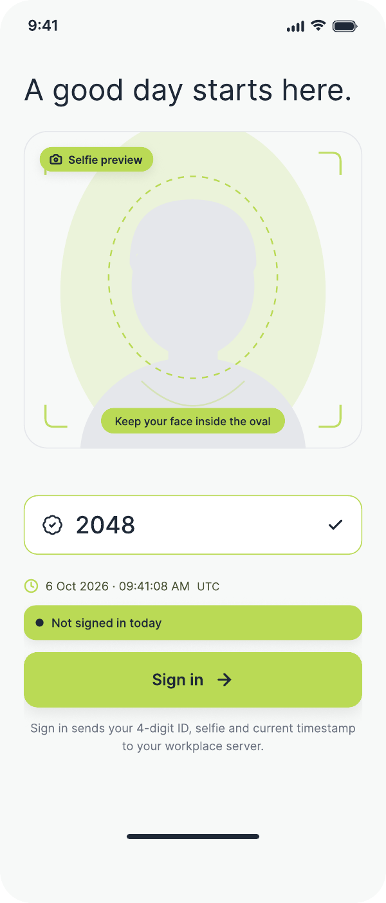
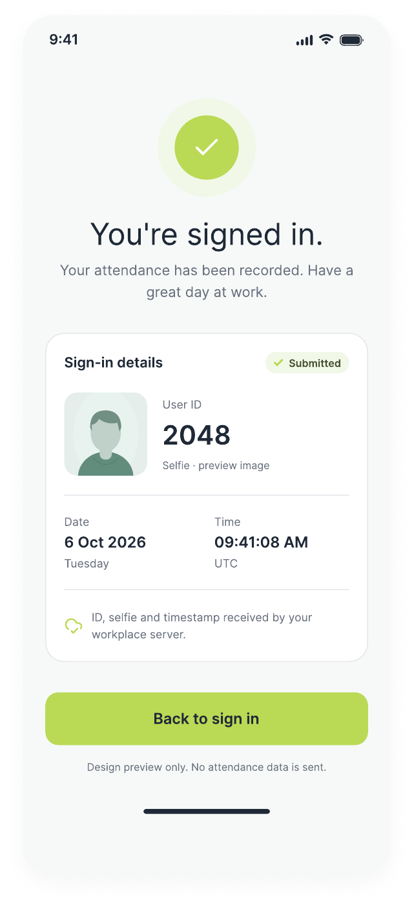

# Pawhub 签到系统统一初步设计文档

> 版本：初稿 v0.1 · 日期：2026-10-07。本文整合 App 页面设计、业务流程和后台功能。功能尚未实现；待定事项不视为已确认设计。

## 文档导航

- 第 1–5 节：产品用途、统一登录、门店及个人签到、记录调整。
- 第 6 节：已确认需求检查项。
- 第 7 节：后台角色、API 配置及 Timesheet。
- 第 8 节：App 界面、页面状态与页面流程。
- 第 9 节：后续待确定事项。

## 1. 用途与用户

App 用于 groomer 的日常签到及记录查询。现阶段仅记录准确的 Sign In / Sign Out 时间，不计算或显示工作时间；具体计算逻辑由用户后续提供。

- Groomer：签到、签退、查询自己的记录，以及新增、修改或删除特定 Sign 记录的时间。
- Manager：可以调整签到记录；其操作界面及权限规则尚待设计。

## 2. 统一登录与签到方式

App 不提供独立的门店/个人模式选择设置。未登录时显示统一登录界面，输入四位数字账号 ID 和密码，后台验证账号及密码后，根据账号类型进入对应签到界面：

| 方式 | 使用设备 |
| --- | --- |
| 门店签到 | 店铺内的固定设备 |
| 手机签到（个人签到） | Groomer 自己手机中的 App |

店铺账号 ID 为 `0001`–`0099`，保留前两位 `00`；个人账号 ID 为 `1000`–`9999`。两个范围不重叠，`0000` 及其他范围不用于这两类账号登录。店铺 ID 必须按四位格式保存和输入，不能丢失前导零。

### 2.1 用户类型与管理

两种签到方式需要设置以下两种用户：

| 用户类型 | 信息字段 |
| --- | --- |
| 店铺（Shop） | 店铺名称（Shop Name）、地址（Address）、GPS 坐标（纬度、经度）、唯一 ID（Unique ID）、密码（Password） |
| 工作人员（Groomer / Other Workers） | 姓名（Name）、联系方式（Contact）、注册邮箱（Email）、地址（Address）、四位数字唯一 ID（Unique ID）、密码（Password） |

Groomer 的数据表还需记录发送 Timesheet 的频率，候选周期为每周（1 week）、每两周（fortnight）或每月（1 month）。具体频率配置及周期规则待定。

用户不开放自行注册，店铺和工作人员用户都需要在 backend 添加。个人账号由 manager 在后台创建，并向个人注册邮箱发送链接，由本人通过链接设置密码；该流程不是公开注册入口。

Manager 在后台添加店铺时必须设置店铺 GPS 坐标（纬度、经度），App 读取后台配置的坐标，用于店铺自动选择及 500 米范围判断。

两类用户均需要密码。个人用户的后台管理界面支持发送首次设置密码及密码重置链接，由本人设置密码。店铺密码直接在后台设置或修改，忘记密码时也由后台直接重置，不发送邮件链接。密码应以安全哈希形式保存，不保存明文密码。

工作人员（Groomer / Other Workers）的 Unique ID 就是签到及个人登录使用的四位数字 ID，不另设签到 ID。ID 范围为 `1000`–`9999`。店铺的 Unique ID 就是店铺登录账号，范围为 `0001`–`0099`，每个店铺的 ID 唯一。

后台添加工作人员时，随机生成四位数字 Unique ID（`1000`–`9999`）。生成后检查唯一性，若与已有工作人员 ID 重复，则重新生成；该 ID 用于签到身份识别。

### 2.2 登录、退出与更换店铺

使用店铺四位数字 Unique ID 和密码登录后，进入门店签到界面并绑定对应店铺，读取后台的店铺名称等信息，不另设用户名或手动选择签到模式。

门店更换绑定店铺需要验证当前店铺密码，再使用目标店铺 ID 和密码登录并绑定。

个人模式下需先退出个人登录，才能使用店铺 ID 和密码登录门店账号。重新使用个人签到时，需要使用个人四位数字 ID 和密码登录。签到界面由已登录账号类型决定，不提供直接切换模式的开关。

## 3. 门店签到主界面

主界面包含：

1. 已配置的店铺名称。
2. Selfie preview（自拍摄像头预览）。
3. 四位数字 ID 输入框，用于确认 groomer 身份。
4. 当前日期和时间，显示 Auckland 当地时间。
5. Sign In / Sign Out 按钮。
6. 独立的查看签到记录按钮。

四位数字 ID 的有效范围为 `1000`–`9999`。Auckland 时间采用 `Pacific/Auckland` 时区，随夏令时变化，不能固定为 UTC+12 或 UTC+13。

### 3.1 Sign In / Sign Out 状态

根据已识别 groomer 当天的签到状态显示按钮：

| 当天状态 | 按钮文字 | 点击后的操作 |
| --- | --- | --- |
| 没有签到记录 | Sign In | 签到 |
| 已 Sign In，尚未 Sign Out | Sign Out | 签退 |
| 已 Sign Out | Sign In | 再次签到 |

同一天可以再次签到，因此按钮应依据当前状态判断，不能仅判断当天是否曾经 Sign In。查询对象为当前输入 ID 对应的 groomer；“当天”按 Auckland 日期理解。

新增、修改或删除记录后，按当天调整后的最新一条有效记录判断按钮状态：最新记录为 Sign In 时显示 Sign Out；最新记录为 Sign Out 时显示 Sign In；当天没有有效记录时显示 Sign In。最新记录按调整后的 Sign 时间判断，已删除的记录不参与判断。门店与个人签到采用相同规则。

每天 Auckland 当地时间午夜 00:00，重置所有工作人员的 Sign In / Sign Out 状态，新一天的按钮恢复为 Sign In。门店签到和个人签到采用相同规则；即使前一天尚未 Sign Out，也不将前一天状态延续到新一天。

重置仅影响新一天的签到状态，不删除历史记录，也不自动生成午夜 Sign Out 记录。未闭合的 Sign In / Sign Out 记录由后台提示 manager 处理。页面持续打开跨过午夜或在新一天重新打开时，都应显示重置后的状态。

### 3.2 提交后台

点击签到或签退按钮时，向 backend 提交：

| 数据 | 含义 |
| --- | --- |
| 店铺 | 当前配置的店铺信息 |
| 四位数字 ID | 当前 groomer 的身份标识 |
| Selfie | 本次操作的自拍照片 |
| Timestamp | 本次操作的时间戳 |
| Sign In / Sign Out | 本次操作类型 |

按下 Sign In / Sign Out 按钮的同时拍摄自拍，并随本次签到或签退记录提交。两种签到方式采用相同规则。

界面提示用户确保头像在照片内，但系统不做人脸识别或头像是否入镜的自动检测，也不以识别结果限制签到。

相机不可用时，本次记录保存“相机不可用”状态，不以自拍成功为提交前提；没有成功拍摄的自拍时，不提交虚假照片。

时间戳来源及 backend 接口格式尚待确定。

### 3.3 提交结果与重试

门店签到和个人签到采用相同规则：后台确认保存成功后，才显示签到或签退成功。提交失败时显示失败提示并允许重试，不能提前显示成功。

提交过程中防止重复点击；同一次操作的重复提交或重试不能生成重复记录。即使后台已保存但客户端未收到成功响应，重试也应返回同一条记录的结果。重试沿用该次操作的时间、自拍及状态信息，不重新生成一次签到或签退。具体 API 去重字段另行定义。

两种签到方式均支持离线签到。无网络时提示“无法提交，已本地保存，待网络恢复后同步”，在本地持久保存本次店铺、工作人员 ID、自拍或相机状态、实际操作时间、Sign In / Sign Out 类型，以及适用的 GPS 状态。不能将本地保存显示为后台提交成功；本地保存失败时明确提示失败。

网络恢复后自动提交待同步记录，沿用原始操作时间，不以同步时间替代签到时间。后台确认成功后将记录标为已同步；失败时继续保留数据供重试，重复提交仍需避免重复记录。关闭或重新打开 App 不应丢失待同步数据。

无网络时不提供签到记录查询功能，查询入口提示需要联网；依赖查询界面的记录调整也不可用。离线签到按钮需结合本地待同步记录维护当天状态，并遵循 Auckland 午夜重置规则。离线且没有可用的当天状态时，默认显示 Sign In；后续根据本地签到记录切换状态。

离线产生的 Sign In / Sign Out 记录增加“离线签到”标签，网络恢复并同步到后台后仍保留此标签，供联网后的记录查询显示。标签表示该记录在离线时产生，与当前是否已同步的状态分开保存。门店和个人签到采用相同规则。

### 3.4 主流程

店铺 ID 和密码登录并绑定店铺 → Groomer 打开 App → 查看自拍预览并输入个人四位数字 ID → 查询当天状态 → 显示 Sign In 或 Sign Out → 点击按钮 → 提交店铺、个人 ID、自拍、时间戳和操作类型到 backend。

### 3.5 公用设备复位

门店公用设备在操作完成后，清空当前 groomer 的四位数字 ID 和个人记录展示，恢复待签到界面，供下一位工作人员使用。复位不删除后台记录，也不解除店铺绑定。

退出记录查询页面或连续 60 秒无操作时，同样清空当前 groomer ID、个人记录展示及个人编辑内容，并返回待签到界面。自动复位前不显示即将退出提示。自动复位不得清除已保存的后台记录或本地待同步数据。

在线提交失败且尚未安全保存到本地时，不视为操作完成，应保留该次操作的数据用于重试。离线记录成功持久保存到本地后，可以复位供下一位工作人员使用，但不能清除待同步队列。个人手机不适用此公用设备复位规则，仍保持本人登录状态。

## 4. 签到记录界面

点击主界面中独立的查看记录按钮，跳转到新界面，查看当前 groomer 的记录。

门店模式只能查询当前配置店铺内、当前输入四位数字 ID 对应工作人员的签到记录。可以切换日期，不能切换到其他店铺查询；后台也必须限制查询范围为本店。

门店模式暂时仅通过输入工作人员四位数字 ID 查询及调整其记录；新增、修改或删除记录时，不额外验证 groomer 密码。此规则不改变店铺设备登录和个人签到登录的密码要求。

该界面包含：

- 日期选择器，默认查询当天，也可以选择其他日期。
- 所选日期的签到和签退历史。
- 所选日期各条 Sign 记录的准确时间。
- 新增、修改和删除时间记录的入口或编辑界面。
- 原始记录、本人调整记录和 manager 调整记录。

### 4.1 查询流程

输入 groomer ID → 点击查看记录 → 查看当天各条 Sign 记录的时间及历史 → 选择其他日期 → 查询该日期的签到、签退及调整历史。

### 4.2 修改与历史保留

Groomer 可以在记录界面新增、修改或删除特定 Sign 记录的时间。店铺和四位数字 ID 不可修改；本人调整范围仅限时间，不开放其他字段的修改。

| 操作 | 范围 |
| --- | --- |
| 新增 | 为当前店铺及当前 groomer 增加一条时间记录，由操作者选择 Sign In 或 Sign Out 类型并填写时间 |
| 修改 | 修改某条特定 Sign 记录的时间 |
| 删除 | 删除某条特定 Sign 时间记录，但保留其原始内容及删除操作历史 |

原始记录及所有新增、修改、删除操作都必须保存到 backend。修改不能覆盖原始内容；删除也不能清除后台保存的原始记录及历史。新增记录时由操作者选择 Sign In / Sign Out 类型；这不开放已有记录类型的修改。

历史应能够区分：

| 类别 | 内容 |
| --- | --- |
| 原始记录 | 签到设备提交的原始签到或签退记录 |
| 本人调整 | Groomer 对自己时间记录的新增、修改或删除 |
| Manager 调整 | Manager 对记录的调整 |

为支持追溯，调整记录需能够关联被调整的记录、标明调整来源和操作类型，并保留操作前后的时间内容。新增、修改或删除时间记录均不需要填写调整原因，两种签到方式采用相同规则。具体后台字段尚待设计。Manager 的可编辑范围尚未确定。

### 4.3 Manager 验证与正式时间

不为本人调整和 manager 调整设置自动优先级，也不依靠修改先后自动决定正式计算时间。

原始 Sign 时间作为正式计算时间的初始依据。凡有调整的记录，均需 manager 在后台 validate 后，才能将确认后的时间记入对应 Sign In / Sign Out 的 `hrs`，作为后续工时计算的正式依据。这里的 `hrs` 指用于计算的确认时间，工时计算公式及后台字段的具体结构仍待后续设计。

待验证调整必须与已确认的正式时间区分显示和保存，不能直接覆盖正式时间。原始记录、各次调整及 manager 验证结果均保留。Groomer 新增、修改或删除时间记录后，后台向 manager 显示调整提示，由 manager 检查并确认其正式结果。Manager 也可在后台直接调整并确认记录。

员工提交调整后，即使 manager 尚未 validate，前端 Sign In / Sign Out 按钮也立即按当天调整后的最新有效记录切换。该按钮状态更新不代表调整已通过验证，也不更新正式计算时间 `hrs`；正式时间仍需 manager validate 后更新。

| 场景 | 处理流程 |
| --- | --- |
| Groomer 发现时间有误 | 前端提交调整 → 后台提示 manager → Manager validate → 更新对应正式时间 |
| Groomer 未发现，但记录未闭合或缺失导致无法正确计算工时 | 后台提示 manager 检查并修改 → Manager 确认正式记录 |
| 记录闭合且可以计算，但时间与实际不符 | 系统不自动识别此类问题；员工与 manager 沟通后，由 manager 在后台修改并确认，或员工在前端修改后由 manager validate |

异常提示针对记录完整性和能否正确计算，不推断记录是否符合实际工作情况，也不承诺发现所有缺失时段。异常检测及工时计算的具体规则后续提供。

## 5. 个人签到（手机签到）

### 5.1 首次登录

App 未登录时，输入 groomer 的四位数字 ID 和密码，验证成功后自动进入个人签到界面。登录账号就是现有的四位数字 Unique ID，不另设用户名；ID 范围为 `1000`–`9999`。

流程：统一登录界面 → 输入 groomer 四位数字 ID 及密码 → 后台验证 → 根据个人账号类型进入个人签到界面。

登录成功后保持登录状态，并提供退出登录入口；退出后再次进入个人签到需要重新登录。

个人账号与密码流程：

| 场景 | 流程 |
| --- | --- |
| 首次创建账号 | Manager 在后台添加个人账号及注册邮箱 → 后台发送邮件链接 → 本人打开链接设置密码 → 使用四位数字 ID 和密码登录 |
| 修改密码 | 本人发起修改密码 → 后台向该账号注册邮箱发送链接 → 本人通过链接设置新密码 |
| 忘记密码 | 本人通过忘记密码入口申请重置 → 后台向该账号注册邮箱发送链接 → 本人通过链接设置新密码 |

首次设置、修改及重置密码的邮件链接自发送起一周（7 天）后失效，且只能成功使用一次。失效或已使用的链接不能再次设置密码。

修改或重置密码成功后，注销该个人账号所有已有登录状态；本人需要使用四位数字 ID 和新密码重新登录。

### 5.2 签到及记录界面

个人登录后，签到界面格式与门店签到保持一致，包括自拍预览、店铺、Auckland 当前日期和时间、Sign In / Sign Out 按钮，以及独立的记录查询入口。沿用已确认的签到状态切换、记录查询和时间调整历史保留规则，暂不计算工作时间。

### 5.3 店铺选择与 GPS 范围

个人签到可以手动选择店铺，也可以根据当前 GPS 所处范围自动设置店铺。

店铺需设置 GPS 坐标，签到范围为以店铺坐标为中心、半径 500 米。当前 GPS 位置与已设置店铺的距离小于或等于 500 米时，判定为范围内；超过 500 米时，判定为范围外。

范围外仍允许签到，但界面提示“不在店铺范围内”，并在该次签到记录中保存、显示“不在店铺范围内”的标记。范围外提示不阻止提交。

定位失败时，允许用户手动选择店铺并签到。界面及记录使用独立的“定位失败”状态，与“不在店铺范围内”分别显示，不能认定为范围内或范围外。

多个店铺范围重叠、当前位置同时处于多个店铺范围内时，由用户选择签到店铺。店铺坐标由 manager 在后台添加店铺时设置，App 读取后台配置。

流程：个人登录 → 手动选择店铺或通过 GPS 自动设置店铺 → 检查当前位置与店铺的距离 → 超出范围时显示提示 → 点击 Sign In / Sign Out → 提交记录并保留本次范围判断结果。

### 5.4 两种签到方式共用后台

门店签到和个人签到使用同一张签到记录表，并通过同一个 API 接收签到或签退数据。

两种方式都提交店铺、工作人员四位数字 ID、自拍、时间戳及 Sign In / Sign Out 类型。个人签到还需提交支持保存“不在店铺范围内”标记的定位范围信息，具体字段格式待定义。两种方式沿用同样的记录查询及调整历史保留规则。

### 5.5 个人签到记录查询与调整

个人界面提供查询本人签到记录的入口，查询界面的布局、记录展示及调整逻辑与门店签到保持一致，但店铺查询范围不同：门店模式仅限本店，个人模式可切换店铺查询本人记录。

- 默认选择当前 Auckland 日期和当前签到界面设置的店铺。
- 可以选择其他日期及其他店铺，查询本人在所选日期、所选店铺的签到记录。
- 查询对象始终为当前登录的工作人员，切换店铺或日期不会切换人员。
- 显示原始记录、本人调整和 manager 调整；范围外签到记录显示“不在店铺范围内”标记。
- 可以新增、修改或删除特定 Sign 时间记录，逻辑与门店签到一致。
- 查询时选择其他店铺不代表修改已有记录的店铺；调整已有记录时，店铺和四位数字 ID 仍不可修改，仅允许时间调整。
- 后台保留原始记录及全部新增、修改、删除历史，暂不计算工作时间。

流程：进入个人记录查询界面 → 默认查询当天、当前店铺的本人记录 → 根据需要切换日期或店铺 → 查看本人记录及调整历史 → 新增、修改或删除时间记录 → 后台保存调整历史。

## 6. 已确认的需求检查项

- 未登录时使用统一登录界面，根据有效账号类型进入门店或个人签到，不手动选择模式。
- 店铺登录 ID 为 `0001`–`0099`，个人登录 ID 为 `1000`–`9999`。
- 门店设备通过店铺 Unique ID 和密码登录并绑定店铺；更换店铺需验证当前店铺密码及目标店铺账号密码。
- 个人账号退出后可使用店铺账号登录；重新使用个人签到需个人账号密码登录。
- 店铺密码直接在后台设置、修改或重置，不使用邮件链接。
- 用户分为店铺和工作人员（Groomer / Other Workers），各自包含上述信息字段；不开放注册，仅通过 backend 添加。
- 两类用户都需要密码；个人签到使用 groomer 的四位数字 ID 和密码，登录后保持登录并提供退出入口。
- Manager 在后台创建个人账号并向注册邮箱发送设置密码链接；本人可通过邮件链接完成首次密码设置、修改密码或忘记密码重置。
- 密码邮件链接有效期为一周，且只能使用一次；修改或重置密码后退出该账号所有已有登录，需使用新密码重新登录。
- 门店主界面显示自拍预览、四位数字 ID、Auckland 当前日期和时间。
- 按钮根据当前 groomer 当天状态，在 Sign In 和 Sign Out 之间切换。
- 调整记录后按当天最新有效 Sign 记录更新按钮；已删除记录不参与判断，无有效记录时显示 Sign In。
- 每天 Auckland 时间 00:00 重置全部签到状态，按钮恢复 Sign In；未闭合记录保留并交由后台处理。
- 每次签到或签退向 backend 提交店铺、ID、自拍、时间戳和操作类型。
- 按下 Sign In / Sign Out 时同步自拍；相机不可用时保存“相机不可用”状态。提示头像应在照片内，但不进行自动识别或检测。
- 后台确认保存成功后才显示签到或签退成功；失败允许重试，同一次操作不产生重复记录。
- 两种方式均支持离线签到，本地持久保存数据，网络恢复后提交；离线期间不提供记录查询功能。
- 离线且无法确定当天状态时默认 Sign In；离线产生的记录带“离线签到”标签，同步后仍保留并显示。
- 门店公用设备操作完成后清空 groomer ID 和个人记录展示，恢复待签到界面；保留店铺绑定及后台数据。
- 门店公用设备退出查询页面或连续 60 秒无操作后清空个人信息并复位，不提前提示，保留本地待同步数据。
- 个人签到界面格式与门店一致，支持手动选择店铺或根据 GPS 范围自动设置店铺。
- 个人签到超出店铺范围时仍允许提交，界面提示且记录显示“不在店铺范围内”。
- 店铺设置 GPS 坐标，范围半径为 500 米；“定位失败”与“不在店铺范围内”分别显示和记录。
- Manager 在后台添加店铺时必须设置 GPS 坐标，App 读取该配置。
- 定位失败时允许手动选择店铺签到，并记录“定位失败”；多个店铺范围重叠时由用户选择店铺。
- 门店和个人签到共用同一张签到记录表、同一个签到数据接收 API。
- 个人查询界面与门店一致，默认当前日期及当前店铺，支持查询其他日期、其他店铺的本人记录，并沿用门店记录调整规则。
- 独立按钮进入该 groomer 的记录界面，默认查看当天各条 Sign 记录的准确时间；暂不计算工作时间。
- 可以按日期查询历史记录。
- 门店模式只能查询本店记录，不允许查询其他店铺；个人模式可以切换店铺，但始终仅查询本人记录。
- 本人可新增、修改或删除特定 Sign 时间记录，不能修改店铺、四位数字 ID 或其他字段。
- 后台保留原始记录及新增、修改、删除历史。
- 调整不设置自动优先级；有调整的记录需 manager validate 后更新正式计算用的 Sign In / Sign Out 时间（`hrs`），并保留验证历史。
- 员工调整提交后立即影响签到按钮状态，无需等待 manager validate；正式计算时间仍须验证后更新。
- 后台提示 manager 处理本人调整及未闭合、无法正确计算工时的异常；闭合且可计算但与实际不符的情况通过员工与 manager 沟通解决。
- 新增、修改或删除时间记录不需要填写调整原因。
- 新增记录时由操作者选择 Sign In 或 Sign Out 类型，并填写时间；门店与个人签到采用相同规则。
- 门店模式查询及新增、修改、删除记录暂时仅使用工作人员四位数字 ID，不额外验证 groomer 密码。
- 查询结果包含原始记录、本人调整及 manager 调整。

## 7. Backend 角色与账号管理

### 7.1 后台角色

| 角色 | 持有人及职责 | 权限范围 |
| --- | --- | --- |
| Super Manager | Owner 持有 | 拥有全部功能，管理所有店铺，创建及设置 manager 账号并分配其管理店铺 |
| IT | 系统维护人员使用的 IT 账号 | 用于维护系统；具体维护权限尚待定义 |
| Manager | 店铺管理人员 | 只能管理 Super Manager 分配给自己的店铺 |

Manager 的店铺限制必须在后台执行，不能仅通过隐藏界面入口实现。查询、调整及验证签到记录等管理操作均限定在分配的店铺范围内。IT 账号的系统维护职责不自动等同于全部业务管理权限。

### 7.2 Manager 账号创建与密码流程

Manager 不开放自行注册，由 Super Manager 在后台创建账号、填写注册邮箱并分配管理店铺。

注册及密码流程与 groomer 一致：后台发送链接到注册邮箱，由本人设置首次密码；修改或忘记密码时通过邮件链接设置新密码。链接一周后失效且只能使用一次；修改或重置密码后退出该账号所有已有登录，需要使用新密码重新登录。

Manager 使用注册邮箱和密码登录后台，不使用 groomer 的四位数字 ID 登录。

### 7.3 兼任 Manager 与 Groomer

同一人兼任 manager 和 groomer 时，必须拥有两个独立账号：manager 账号用于后台店铺管理，groomer 账号用于日常签到及查询本人记录，不合并为一个多角色账号。

### 7.4 前后端通信与后端域名配置

Backend 通过 API 与前端 App 通信，功能范围沿用本文已确认的登录、签到提交、离线同步、记录查询及调整等需求。门店与个人签到继续共用同一个签到数据接收 API。

前端提供后端域名（Domain）的配置入口，用户可以填写并保存 App 所连接的后端域名，API 地址根据该域名确定。该设置用于指定后端服务，不用于选择门店或个人模式；签到界面仍由登录账号类型决定。

后端域名的默认值、配置入口的访问权限，以及更换域名时已有登录和待同步离线数据如何处理，尚待确定。

### 7.5 定期发送 Timesheet

Manager 需要根据各 groomer 的频率设置，定期将 Timesheet 发送到其注册邮箱，作为工时记录及发放薪酬的记录。

通常按两周或四周发送；目前提出的配置选项为每周、fortnight 或每月。四周与一个自然月不等同，最终采用哪些周期、周期起止日期及发送时间均待确定，不将两者混为同一周期。

Timesheet 的格式、内容及发送流程（manager 手动发起或系统定时发送）待定。具体工时计算规则也待定；后续计算应沿用已确认的正式 Sign In / Sign Out 时间 `hrs`，有调整的记录须经 manager validate 后进入正式计算依据。

## 8. App 界面设计

### 8.1 视觉风格

采用浅色背景、深色文字、青绿色主要按钮、圆角卡片和大面积自拍预览。各页面保持统一的颜色、字体与操作风格。

### 8.2 签到主界面

主界面以欢迎文案、自拍预览、身份信息、当前时间、签到状态和主要操作按钮为核心。

- 门店界面显示绑定店铺名称，并提供工作人员四位数字 ID 输入框。
- 个人界面使用已登录工作人员身份，支持手动选择店铺或根据 GPS 自动设置店铺。
- 自拍预览使用椭圆框提示头像入镜，不进行自动识别。
- 日期和时间使用 Auckland 当地时间，并自动处理夏令时。
- 按钮根据当天最新有效记录显示 Sign In 或 Sign Out，点击时同步自拍。
- 提供独立的记录查询入口；离线时该入口提示需要联网。
- 显示适用的 GPS、相机及离线状态。

### 8.3 签到结果界面

结果界面包含操作结果、记录详情及返回按钮。

- 后台确认保存后，显示签到或签退成功和 Submitted 状态。
- 详情包括店铺、工作人员 ID、自拍或相机状态、操作类型，以及 Auckland 日期和时间。
- 离线保存显示“已本地保存，待同步”，不显示后台提交成功。
- 门店操作完成后清空个人信息，返回待签到界面，保留店铺绑定和待同步数据。
- 个人返回签到界面后保持登录，按钮依据当前状态显示。

### 8.4 页面状态

| 状态 | 界面表现 | 记录处理 |
| --- | --- | --- |
| 在线提交中 | 显示提交中，防止重复点击 | 同一次操作不产生重复记录 |
| 后台确认成功 | 显示签到或签退成功 | 保存本次提交数据 |
| 提交失败 | 提示失败，允许重试 | 保留原始操作数据 |
| 离线保存成功 | 显示待同步，不提供查询 | 保留离线签到标签，联网后自动提交 |
| 本地保存失败 | 明确显示失败 | 不显示保存成功 |
| 相机不可用 | 提示相机不可用，仍可签到 | 保存相机不可用状态 |
| 超出店铺 500 米范围 | 提示不在店铺范围内，仍可签到 | 保存范围外标记 |
| 定位失败 | 允许手动选店签到 | 保存定位失败状态 |
| 调整待验证 | 区分调整内容与正式时间 | Manager validate 后更新正式时间 hrs |

### 8.5 页面结构

| 页面 | 主要内容 |
| --- | --- |
| 统一登录 | 四位 ID、密码，根据账号类型进入对应签到界面 |
| 门店签到 | 店铺、自拍、工作人员 ID、Auckland 时间、签到状态、记录入口 |
| 个人签到 | 本人身份、店铺选择、GPS 状态、自拍、签到状态、记录入口 |
| 签到结果 | 在线成功、失败或离线待同步结果及返回行为 |
| 记录查询 | 日期、允许查询的店铺、签到记录、原始及调整历史、状态标签 |
| 时间记录新增与编辑 | 新增选择 Sign In / Sign Out，修改时间，删除记录；无需调整原因 |
| 个人账号与密码 | 退出登录、修改及忘记密码入口、邮件链接设置密码 |
| 后端域名配置 | 设置后端 Domain |
| 后台管理 | 用户、店铺、权限、调整验证、异常提示及 Timesheet |

### 8.6 页面流程

统一登录 → 根据账号类型进入签到界面 → 点击按钮并自拍 → 在线提交或离线保存 → 显示结果 → 返回签到界面。

签到界面 → 记录查询 → 选择日期及允许查询的店铺 → 查看记录 → 调整时间记录 → 前端更新签到状态 → Manager validate → 更新正式时间 hrs。

## 9. 后续待设计细节

以下内容尚未确定，不作为已确认规则：

- 四位数字 ID 是全局唯一还是仅在店铺内唯一；输入错误时的显示方式。
- 多设备离线记录同步后的状态冲突处理。
- 工作时间计算逻辑由用户后续提供，当前不实现。
- 后台异常检测的具体规则、manager 可编辑字段及验证界面。
- Manager 的操作界面。
- 个人登录保持的有效期，以及离线设备如何在恢复联网后执行密码变更导致的登录失效。
- 个人登录后是否保留四位数字 ID 输入框。
- Super Manager 及 IT 的登录账号格式和初始账号设置方式。
- IT 账号的具体维护权限。
- 后端域名的默认值、配置权限及更换域名时的登录和待同步数据处理。
- Timesheet 的频率选项、周期起止及发送时间、格式、内容和发送流程，以及待验证或异常记录未处理时如何发送。
